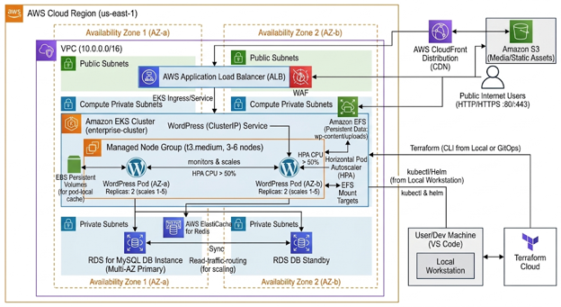
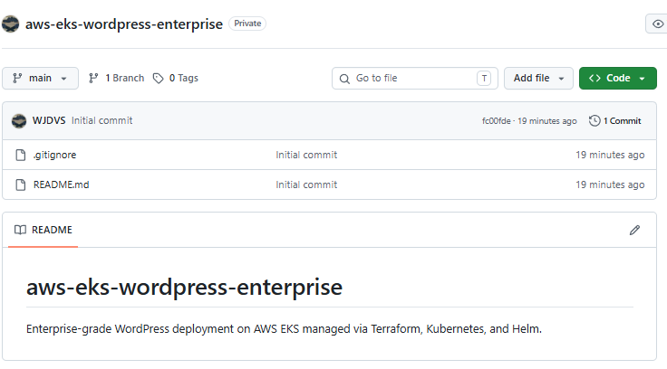
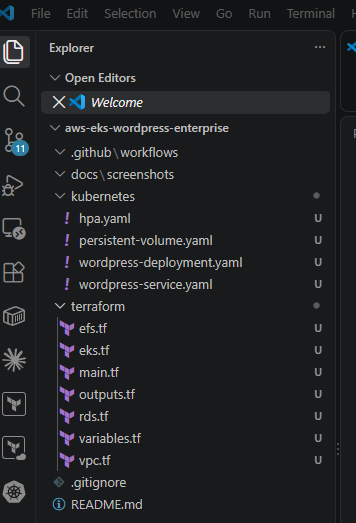
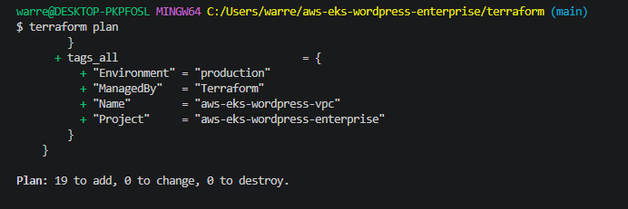
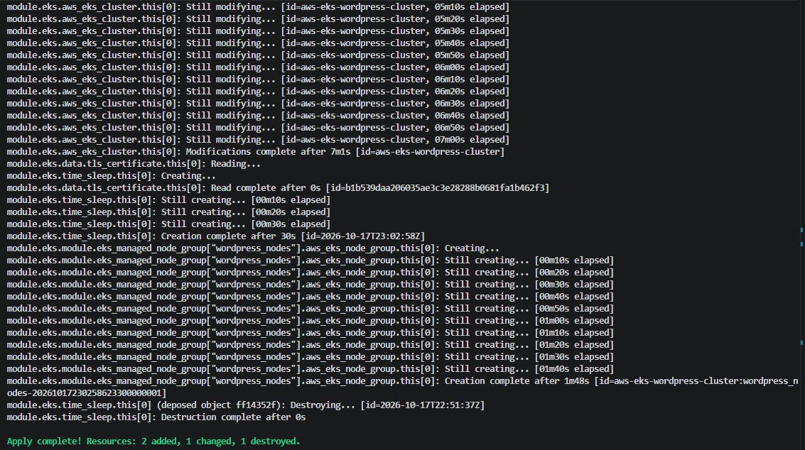
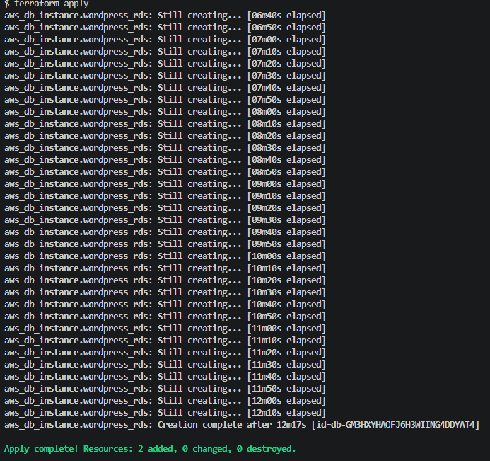
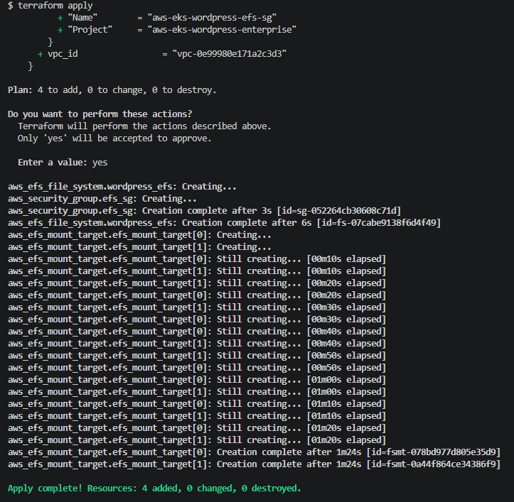

# AWS EKS Enterprise WordPress Infrastructure

An enterprise-grade, highly available WordPress architecture deployed on **Amazon EKS (Elastic Kubernetes Service)**, using **Terraform** for Infrastructure as Code (IaC), **Kubernetes/Helm** for orchestration, and automated **CI/CD** pipelines.

---

## 🏗️ Architecture Overview



| Component | Technology |
| :--- | :--- |
| **Cloud Provider** | AWS (`us-east-1`) |
| **Infrastructure as Code** | Terraform (VPC, EKS, RDS, EFS) |
| **Container Orchestration** | Kubernetes (EKS Managed Node Groups, HPA) |
| **Database** | Amazon RDS for MySQL (Multi-AZ Primary & Standby) |
| **Storage** | Amazon EFS for persistent shared WordPress content (`wp-content/uploads`) |
| **CI/CD** | GitHub Actions |

---

## 📑 Table of Contents

- [Phase 1: Repository Setup, Folder Structure & Version Control](#-phase-1-repository-setup-folder-structure--version-control)
- [Phase 2: Infrastructure Provisioning (Terraform)](#-phase-2-infrastructure-provisioning-terraform)

---

## 📦 Phase 1: Repository Setup, Folder Structure & Version Control

### 🎯 Phase Objectives

- Establish the central Git repository on GitHub (`aws-eks-wordpress-enterprise`) as the project's single source of truth.
- Initialize a local workspace in Visual Studio Code with a modular, scalable directory tree.
- Define initial placeholder configuration files for Terraform, Kubernetes manifests, and automated GitHub Actions workflows.
- Set up project documentation and portfolio screenshot tracking.

### 📂 Project Directory Structure

```text
aws-eks-wordpress-enterprise/
├── .github/workflows/          # CI/CD GitHub Actions pipelines
├── docs/screenshots/           # Visual portfolio documentation
├── terraform/                  # Terraform Infrastructure as Code
│   ├── main.tf                 # Core provider configuration
│   ├── variables.tf            # Input configuration variables
│   ├── outputs.tf              # Connection endpoints and outputs
│   ├── vpc.tf                  # Networking, subnets, and routing
│   ├── eks.tf                  # EKS cluster and compute nodes
│   ├── rds.tf                  # Multi-AZ MySQL database
│   └── efs.tf                  # Elastic File System storage
└── kubernetes/                 # Kubernetes deployment manifests
    ├── wordpress-deployment.yaml
    ├── wordpress-service.yaml
    ├── persistent-volume.yaml
    └── hpa.yaml
```

### 📸 Portfolio Screenshots (Phase 1)

| Screenshot File Name | Visual Proof / Content Description |
| :--- | :--- |
| `docs/screenshots/phase1-github-repo.png` | GitHub repository home page showing `aws-eks-wordpress-enterprise`, public visibility, and base `.gitignore`. |
| `docs/screenshots/phase1-vscode-structure.png` | VS Code Explorer tree displaying all created directories (`terraform/`, `kubernetes/`, `docs/screenshots/`) and placeholder `.tf` / `.yaml` files. |




---

## 📁 Phase 2: Infrastructure Provisioning (Terraform)

### 🎯 Phase Objectives

- Configure core AWS provider settings and reusable input variables (`main.tf`, `variables.tf`).
- Provision a highly available Multi-AZ Virtual Private Cloud (`vpc.tf`) featuring public and private subnets, internet gateways, and NAT gateways.
- Deploy an enterprise Amazon EKS cluster (`eks.tf`) running version `1.31` with managed EC2 node groups across private subnets.
- Set up a highly available, Multi-AZ Amazon RDS MySQL database (`rds.tf`) for application data persistence.
- Implement an encrypted Amazon EFS file system (`efs.tf`) with mount targets across all private subnets to provide shared storage for WordPress uploads.

### 🛠️ Step-by-Step Provisioning Summary

#### 1. Core Providers & Input Variables (`main.tf`, `variables.tf`)

- Configured the HashiCorp AWS provider (`~> 5.0`) targeting region `us-east-1`.
- Standardized tags applied globally to all AWS resources:
  - `Project = "aws-eks-wordpress-enterprise"`
  - `ManagedBy = "Terraform"`
  - `Environment = "production"`

#### 2. Multi-AZ Networking (`vpc.tf`)

- Provisioned a VPC with CIDR block `10.0.0.0/16` across Availability Zones `us-east-1a` and `us-east-1b`.
- Configured public subnets (`10.0.1.0/24`, `10.0.2.0/24`) and private subnets (`10.0.10.0/24`, `10.0.11.0/24`).
- Added Kubernetes auto-discovery tags (`kubernetes.io/role/elb` and `kubernetes.io/role/internal-elb`) so the load balancer controller can identify subnets automatically.

#### 3. Kubernetes Cluster & Compute (`eks.tf`)

- Deployed the Amazon EKS cluster `aws-eks-wordpress-cluster` on Kubernetes `v1.31`.
- Configured EKS Managed Node Groups with `t3.medium` instances across private subnets, with auto-scaling boundaries of minimum 2, desired 2, and maximum 4 nodes.

#### 4. Relational Database (`rds.tf`)

- Provisioned an Amazon RDS MySQL 8.0 instance (`db.t3.micro`) with Multi-AZ replication for high availability and failover.
- Placed RDS inside private database subnet groups with restricted network access.

#### 5. Persistent Shared Storage (`efs.tf`)

- Created an encrypted Amazon EFS file system (`aws-eks-wordpress-efs`) in general-purpose mode.
- Deployed EFS mount targets across private subnets with a dedicated security group permitting NFS traffic (port `2049`) from the VPC CIDR.

### 📸 Portfolio Screenshots (Phase 2)

| Screenshot File Name | Visual Proof / Content Description |
| :--- | :--- |
| `docs/screenshots/phase2-vpc-plan.png` | Terminal output showing successful execution of `terraform plan` for VPC network provisioning. |
| `docs/screenshots/phase2-eks-apply.png` | Successful `terraform apply` log output confirming EKS control plane and node group creation. |
| `docs/screenshots/phase2-rds-apply.png` | Terminal confirmation showing the Multi-AZ RDS MySQL database successfully created. |
| `docs/screenshots/phase2-efs-apply.png` | Terminal confirmation verifying the EFS file system, security group, and mount targets created. |




