# AWS EKS Enterprise WordPress Infrastructure

An enterprise-grade, highly available WordPress architecture deployed on **Amazon EKS (Elastic Kubernetes Service)**, using **Terraform** for Infrastructure as Code (IaC), **Kubernetes/Helm** for orchestration, and automated **CI/CD** pipelines.

---

## 🏗️ Architecture Overview


### 📋 Implementation Status

The diagram shows the **target architecture**. This table tracks what is built today.

| Component | Status |
| :--- | :--- |
| VPC, public/private subnets, NAT, Multi-AZ layout | ✅ Implemented |
| Amazon EKS cluster (Kubernetes 1.35) with managed node group | ✅ Implemented (3–6 `t3.medium` nodes) |
| EKS managed add-ons (CoreDNS, kube-proxy, VPC CNI, metrics-server) | ✅ Implemented |
| Amazon RDS for MySQL (Multi-AZ) | ✅ Implemented |
| Amazon EFS shared storage | ✅ Implemented |
| Application Load Balancer via AWS Load Balancer Controller + Ingress | ✅ Implemented |
| AWS WAF (managed rule groups) | ✅ Implemented |
| Amazon CloudFront (HTTPS front door) | ✅ Implemented (ALB origin plus a private S3 media origin) |
| Kubernetes Secrets and credential rotation | ✅ Implemented |
| Horizontal Pod Autoscaler, 2+ replicas across zones, PodDisruptionBudget | ✅ Implemented |
| Amazon ElastiCache for Redis (WordPress object cache) | ✅ Implemented (Multi-AZ replication group) |
| Amazon S3 media offload served through CloudFront | ✅ Implemented (private bucket, CloudFront OAC, IRSA) |
| Terraform remote state (HCP Terraform) | ✅ Implemented (state stored remotely, locked, versioned) |
| GitHub Actions CI/CD | ✅ Implemented (plan on pull requests, approval-gated apply, OIDC to AWS with no stored keys) |

### 🧰 Technology Stack

| Component | Technology |
| :--- | :--- |
| **Cloud Provider** | AWS (`us-east-1`) |
| **Infrastructure as Code** | Terraform (VPC, EKS, RDS, EFS, WAF, CloudFront, ElastiCache, S3, IAM) |
| **Container Orchestration** | Kubernetes 1.35 (EKS Managed Node Groups, managed add-ons) |
| **Autoscaling** | Horizontal Pod Autoscaler driven by metrics-server |
| **Edge / HTTPS** | Amazon CloudFront (default `*.cloudfront.net` certificate) |
| **Web Application Firewall** | AWS WAFv2 (AWS managed rule groups) attached to the ALB |
| **Load Balancing** | Application Load Balancer managed by the AWS Load Balancer Controller |
| **Database** | Amazon RDS for MySQL (Multi-AZ Primary & Standby) |
| **Storage** | Amazon EFS for persistent shared WordPress content, Amazon S3 (private bucket) for offloaded media |
| **Caching** | Amazon ElastiCache for Redis 7.1 (WordPress object cache through the Redis Object Cache plugin and Predis), Amazon CloudFront for media |
| **Pod-to-AWS access** | IAM Roles for Service Accounts (IRSA), so pods use temporary credentials with no stored keys |
| **Remote state** | HCP Terraform (state storage and locking; execution stays local or in GitHub Actions) |
| **CI/CD** | GitHub Actions with OpenID Connect (OIDC) federation to AWS, two IAM roles (read-only plan, approval-gated apply) |

---

## 📑 Table of Contents

- [Phase 1: Repository Setup, Folder Structure & Version Control](#-phase-1-repository-setup-folder-structure--version-control)
- [Phase 2: Infrastructure Provisioning (Terraform)](#-phase-2-infrastructure-provisioning-terraform)
- [Phase 3: Kubernetes Orchestration & Storage Configuration](#-phase-3-kubernetes-orchestration--storage-configuration)
- [Phase 4: Ingress, Load Balancing & Security](#-phase-4-ingress-load-balancing--security)
- [Phase 5: Scalability & Resilience](#-phase-5-scalability--resilience)
- [Phase 6: Performance (Redis Object Cache & S3 Media Offload)](#-phase-6-performance-redis-object-cache--s3-media-offload)
- [Phase 7: Automation (Remote State & CI/CD)](#-phase-7-automation-remote-state--cicd)
- [Known Limitations and Next Improvements](#-known-limitations-and-next-improvements)
- [Roadmap](#-roadmap)

---

## 📦 Phase 1: Repository Setup, Folder Structure & Version Control

### 🎯 Phase Objectives

- Establish the central Git repository on GitHub (`aws-eks-wordpress-enterprise`) as the project's single source of truth.
- Initialize a local workspace in Visual Studio Code with a modular, scalable directory tree.
- Define initial placeholder configuration files for Terraform, Kubernetes manifests, and automated GitHub Actions workflows.
- Set up project documentation and portfolio screenshot tracking.

### 📂 Project Directory Structure (Current)

```text
aws-eks-wordpress-enterprise/
├── .github/workflows/
│   └── terraform.yml           # CI/CD: fmt, validate, plan on PRs; approval-gated apply on main
├── docs/screenshots/           # Visual portfolio documentation
├── terraform/                  # Terraform Infrastructure as Code
│   ├── main.tf                 # Core provider configuration
│   ├── variables.tf            # Input configuration variables
│   ├── outputs.tf              # Connection endpoints and outputs
│   ├── vpc.tf                  # Networking, subnets, and routing
│   ├── security.tf             # Security groups and network access rules
│   ├── eks.tf                  # EKS cluster, managed add-ons, and compute nodes
│   ├── rds.tf                  # Multi-AZ MySQL database
│   ├── efs.tf                  # Elastic File System storage
│   ├── waf.tf                  # WAFv2 Web ACL with managed rule groups
│   ├── cloudfront.tf           # CloudFront distribution (ALB origin + S3 media origin)
│   ├── cloudfront_media.tf     # Origin access control and S3 bucket policy for CloudFront
│   ├── redis.tf                # ElastiCache Redis replication group and security group
│   ├── s3.tf                   # Private S3 bucket for WordPress media
│   ├── irsa_wordpress.tf       # IAM role (IRSA) letting WordPress pods use the media bucket
│   ├── github_oidc.tf          # GitHub OIDC provider and the plan/apply IAM roles for CI/CD
│   └── .terraform.lock.hcl     # Provider version lock file
├── kubernetes/                 # Kubernetes deployment manifests
│   ├── storage-class.yaml      # EFS StorageClass (efs.csi.aws.com)
│   ├── persistent-volume.yaml  # Persistent volume configuration
│   ├── wordpress-pvc.yaml      # ReadWriteMany PersistentVolumeClaim
│   ├── wordpress-deployment.yaml
│   ├── wordpress-serviceaccount.yaml  # ServiceAccount annotated with the IRSA role
│   ├── wordpress-service.yaml
│   ├── ingress.yaml            # ALB Ingress (WAF + CloudFront-only access)
│   ├── hpa.yaml                # Horizontal Pod Autoscaler (2–5 replicas, 70% CPU)
│   └── wordpress-pdb.yaml      # PodDisruptionBudget (keep 1 pod available)
├── iam_policy.json             # AWS Load Balancer Controller IAM policy
├── trust-policy.json           # IAM trust policy
├── .gitignore
└── README.md
```

### 📸 Portfolio Screenshots (Phase 1)

| Screenshot File Name | Visual Proof / Content Description |
| :--- | :--- |
| `docs/screenshots/phase1-github-repo.png` | GitHub repository home page showing `aws-eks-wordpress-enterprise` and the base `.gitignore`. |
| `docs/screenshots/phase1-vscode-structure.png` | VS Code Explorer tree displaying all created directories (`terraform/`, `kubernetes/`, `docs/screenshots/`) and placeholder `.tf` / `.yaml` files. |


> **Note:** Screenshots reflect the initial Phase 1 scaffold; the structure above includes files added in later phases.

---

## 📁 Phase 2: Infrastructure Provisioning (Terraform)

### 🎯 Phase Objectives

- Configure core AWS provider settings and reusable input variables (`main.tf`, `variables.tf`).
- Provision a highly available Multi-AZ Virtual Private Cloud (`vpc.tf`) featuring public and private subnets, internet gateways, and NAT gateways.
- Deploy an enterprise Amazon EKS cluster (`eks.tf`) running version `1.31` with managed EC2 node groups across private subnets. *(Upgraded to `1.35` and resized to 3–6 nodes in Phase 5.)*
- Set up a highly available, Multi-AZ Amazon RDS MySQL database (`rds.tf`) for application data persistence.
- Implement an encrypted Amazon EFS file system (`efs.tf`) with mount targets across all private subnets to provide shared storage for WordPress uploads.

### 🛠️ Step-by-Step Provisioning Summary

#### 1. Core Providers & Input Variables (`main.tf`, `variables.tf`)

- Configured the HashiCorp AWS provider (`~> 5.0`) targeting region `us-east-1`.
- Standardized tags applied globally to all AWS resources:
  - `Project = "aws-eks-wordpress-enterprise"`
  - `ManagedBy = "Terraform"`
  - `Environment = "production"`

#### 2. Multi-AZ Networking (`vpc.tf`)

- Provisioned a VPC with CIDR block `10.0.0.0/16` across Availability Zones `us-east-1a` and `us-east-1b`.
- Configured public subnets (`10.0.1.0/24`, `10.0.2.0/24`) and private subnets (`10.0.10.0/24`, `10.0.11.0/24`).
- Added Kubernetes auto-discovery tags (`kubernetes.io/role/elb` and `kubernetes.io/role/internal-elb`) so the load balancer controller can identify subnets automatically.

#### 3. Kubernetes Cluster & Compute (`eks.tf`)

- Deployed the Amazon EKS cluster `aws-eks-wordpress-cluster` on Kubernetes `v1.31`. *(Now `v1.35`; see Phase 5.)*
- Configured EKS Managed Node Groups with `t3.medium` instances across private subnets, with auto-scaling boundaries of minimum 2, desired 2, and maximum 4 nodes. *(Now 3 / 3 / 6; see Phase 5.)*

#### 4. Relational Database (`rds.tf`)

- Provisioned an Amazon RDS MySQL 8.0 instance (`db.t3.micro`) with Multi-AZ replication for high availability and failover.
- Placed RDS inside private database subnet groups with restricted network access.

#### 5. Persistent Shared Storage (`efs.tf`)

- Created an encrypted Amazon EFS file system (`aws-eks-wordpress-efs`) in general-purpose mode.
- Deployed EFS mount targets across private subnets with a dedicated security group permitting NFS traffic (port `2049`) from the VPC CIDR. *(Narrowed to the EKS worker node security group in Phase 4.)*

### 📸 Portfolio Screenshots (Phase 2)

| Screenshot File Name | Visual Proof / Content Description |
| :--- | :--- |
| `docs/screenshots/phase2-vpc-plan.png` | Terminal output showing successful execution of `terraform plan` for VPC network provisioning. |
| `docs/screenshots/phase2-eks-apply.png` | Successful `terraform apply` log output confirming EKS control plane and node group creation. |
| `docs/screenshots/phase2-rds-apply.png` | Terminal confirmation showing the Multi-AZ RDS MySQL database successfully created. |
| `docs/screenshots/phase2-efs-apply.png` | Terminal confirmation verifying the EFS file system, security group, and mount targets created. |


---

## 🚀 Phase 3: Kubernetes Orchestration & Storage Configuration

> **Note:** AWS resource IDs in this section are masked. Items marked *(Replaced in Phase 4)* describe the initial Phase 3 setup, which Phase 4 later hardened.

### 🎯 Phase Objectives

- Establish cluster credentials and authenticate `kubectl` against the newly provisioned Amazon EKS control plane.
- Implement dynamic persistent volume storage backed by AWS EFS using the `efs.csi.aws.com` provisioner to support multi-pod shared media storage.
- Secure database connectivity by authorizing MySQL port `3306` ingress from the EKS Node Security Group into the RDS Security Group.
- Deploy stateful WordPress container workloads configured to use remote AWS RDS for database operations and AWS EFS for content storage.
- Verify complete application initialization, schema migration, and administrative panel access.

### 🛠️ Step-by-Step Orchestration Summary

#### 1. Cluster Authentication & Storage Class Setup

- Configured the local `kubeconfig` context for the Amazon EKS cluster using `aws eks update-kubeconfig`.
- Deployed the `efs-sc` StorageClass utilizing `efs.csi.aws.com` in Access Point mode (`efs-ap`) pointing to EFS file system `fs-0xxxxxxxxxxxxxxxx`.
- Created `wordpress-efs-pvc` with `ReadWriteMany` (RWX) access mode, enabling simultaneous read and write access across auto-scaled pods.

#### 2. Network Inbound Authorization & Security

- Identified the EKS worker node security group (`sg-0xxxxxxxxxxxxxxxx`).
- Updated the RDS security group (`sg-0yyyyyyyyyyyyyyyy`) with an inbound rule permitting MySQL/Aurora traffic (TCP port `3306`) sourced directly from the EKS worker nodes.

#### 3. WordPress Workload Deployment & Verification

- Configured the RDS database credentials for the WordPress container as environment variables. *(They were initially plain values in the Deployment manifest; Phase 4 moved them into a Kubernetes Secret and rotated the password.)*
- Applied `wordpress-deployment.yaml` and `wordpress-service.yaml`, creating an AWS Classic Load Balancer pointing to port `80` of the WordPress pods. *(Replaced in Phase 4 by an Application Load Balancer created from an Ingress.)*
- Established local tunneling via `kubectl port-forward` to test and complete the WordPress installation wizard.
- Verified database writing and table schema creation on AWS RDS via successful login to `/wp-admin/`.

### 📸 Portfolio Screenshots (Phase 3)

| Screenshot File Name | Visual Proof / Content Description |
| :--- | :--- |
| `docs/screenshots/rds-security-group-inbound-rule.png` | AWS EC2/RDS Security Group configuration displaying the inbound rule for MySQL/Aurora traffic on port `3306` authorized from the EKS Node Security Group (`sg-0xxxxxxxxxxxxxxxx`). |
| `docs/screenshots/wordpress-already-installed.png` | WordPress setup interface (`/wp-admin/install.php`) confirming successful connection to the AWS RDS MySQL instance and existing table schema initialization. |
| `docs/screenshots/wordpress-admin-dashboard.png` | Active WordPress Administrative Dashboard (`/wp-admin/`) demonstrating complete application accessibility and system state integrity. |
| `docs/screenshots/kubectl-cluster-resources.png` | Terminal output displaying `kubectl get pods -o wide`, `kubectl get pvc,pv`, and `kubectl get svc`, verifying running WordPress pods (`1/1 Running`), bound EFS PersistentVolumeClaim (`5Gi`, RWX), and active LoadBalancer. |

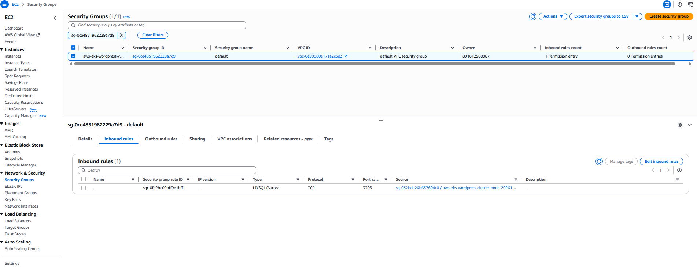
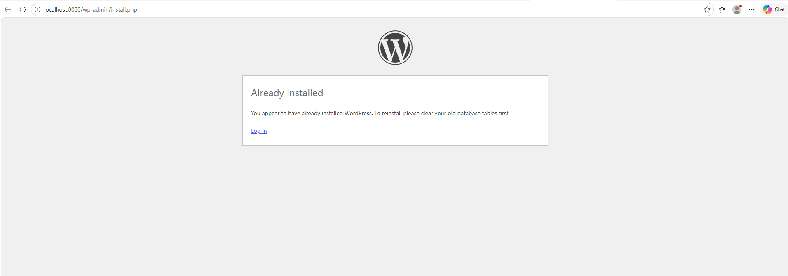
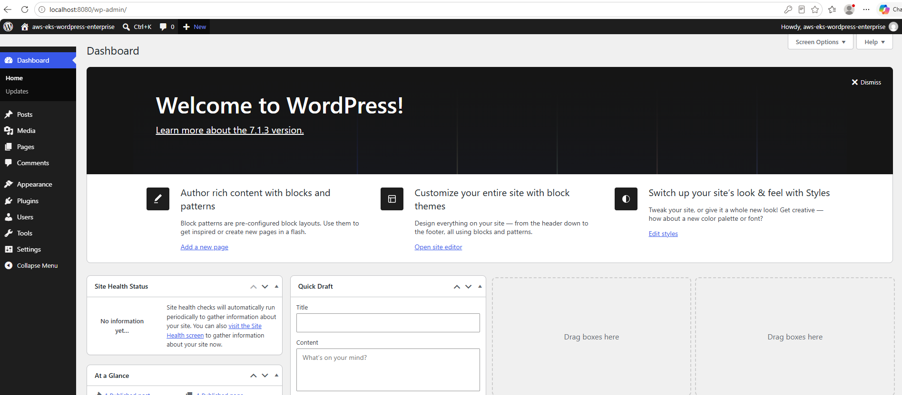
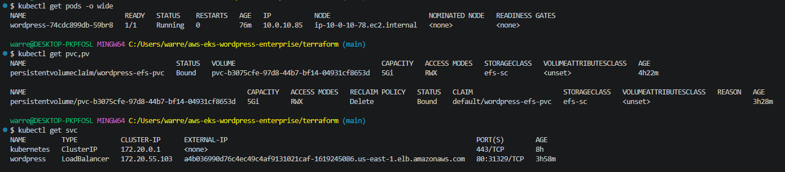

---

## 🔐 Phase 4: Ingress, Load Balancing & Security

### 🎯 Phase Objectives

- Replace the Phase 3 Classic Load Balancer with an **Application Load Balancer** created from a Kubernetes **Ingress** by the AWS Load Balancer Controller.
- Remove hardcoded database credentials from the repository using a **Kubernetes Secret** and a **sensitive Terraform variable**, and rotate the exposed password.
- Protect the application with **AWS WAFv2** managed rule groups and verify that attack-style requests are blocked.
- Serve the site over **HTTPS** with **Amazon CloudFront** (no custom domain), and restrict the ALB so only CloudFront can reach it.
- Apply least-privilege network rules to the shared storage.

### 🏗️ Traffic Flow

```text
Browser ──HTTPS──▶ CloudFront ──HTTP──▶ ALB (WAF attached) ──▶ WordPress pods ──▶ RDS MySQL / EFS
```

### 🛠️ Step-by-Step Summary

#### 1. Ingress and Application Load Balancer

- Installed the **AWS Load Balancer Controller** (Helm chart `3.6.0`) with an IAM role bound to its Kubernetes service account (IRSA), so it receives temporary AWS credentials without stored keys.
- Created `wordpress-ingress` (`ingressClassName: alb`, `scheme: internet-facing`, `target-type: ip`) so the ALB sends traffic directly to WordPress pod IPs in the private subnets.
- Health checks use path `/` and accept `200`, `301`, and `302`.
- Changed the `wordpress` Service from `LoadBalancer` to `ClusterIP`, which removed the Phase 3 Classic Load Balancer and its second public entry point.

#### 2. Secrets Management

- Moved the database user and password out of `wordpress-deployment.yaml` into the Kubernetes Secret `wordpress-db-secret`, referenced with `secretKeyRef`.
- Replaced the hardcoded password in `rds.tf` with a **sensitive** Terraform variable (`db_password`) supplied through `TF_VAR_db_password`.
- **Rotated** the RDS master password, so credentials that existed in earlier commits no longer work.
- Verified the Git history contains no state files, key files, or AWS access keys before publishing.
- Disabled WordPress debug mode so PHP errors are not shown to visitors.

#### 3. WordPress Address Handling

- Set `WP_HOME` and `WP_SITEURL` in `WORDPRESS_CONFIG_EXTRA` from the request host and the forwarded protocol (`CloudFront-Forwarded-Proto` and `X-Forwarded-Proto`). This fixed redirects to the port-forward address (`:8080`) left over from the install, and makes WordPress treat HTTPS visitors as secure.

#### 4. Web Application Firewall

- Created a regional WAFv2 Web ACL, `aws-eks-wordpress-waf`, in `waf.tf` with three AWS managed rule groups: **Common Rule Set**, **SQL Injection Rule Set**, and **WordPress Rule Set**.
- Attached it to the ALB with the Ingress annotation `alb.ingress.kubernetes.io/wafv2-acl-arn`.
- Verified protection with harmless attack-style requests (script injection, path traversal, SQL injection pattern). Each returned `403 Forbidden`, while normal requests returned `200`.

#### 5. Network Hardening

- Audited the VPC's security groups: only the ALB's group accepted traffic from `0.0.0.0/0`.
- Narrowed the EFS security group from "NFS (2049) from the whole VPC CIDR" to "NFS from the EKS worker node security group", then deleted the WordPress pod to prove a brand-new pod can still mount the storage.

#### 6. HTTPS with CloudFront

- Created a CloudFront distribution in `cloudfront.tf`: default CloudFront certificate, `redirect-to-https` for viewers, the managed **CachingDisabled** cache policy, and the managed **AllViewerAndCloudFrontHeaders** origin request policy so cookies, headers, and logins work.
- Restricted the ALB to CloudFront using the AWS-managed CloudFront origin-facing **prefix list** (Ingress annotation `security-group-prefix-lists`). A direct request to the ALB now times out, so all traffic passes through CloudFront and then WAF.

### 📸 Portfolio Screenshots (Phase 4)

| Screenshot File Name | Visual Proof / Content Description |
| :--- | :--- |
| `docs/screenshots/phase4-aws-load-balancer.png` | Application Load Balancer created by the AWS Load Balancer Controller from the Ingress. |
| `docs/screenshots/phase4-wordpress-via-alb.png` | WordPress served through the ALB before CloudFront was added. |
| `docs/screenshots/phase4-wordpress-debug-off.png` | WordPress after debug display was disabled. |
| `docs/screenshots/phase4-waf-test-403.png` | Terminal showing `403` responses to script injection, path traversal, and SQL injection patterns, with `200` for a normal request. |
| `docs/screenshots/phase4-waf-blocked-requests.png` | WAF console showing blocked requests and the rule groups that matched. |
| `docs/screenshots/phase4-efs-mount.png` | `df -h` inside a freshly started pod showing the EFS mount at `/var/www/html`. |
| `docs/screenshots/phase4-cloudfront-https.png` | WordPress served over HTTPS (padlock) from the CloudFront address. |
| `docs/screenshots/phase4-wp-admin-https.png` | WordPress admin dashboard loaded over HTTPS through CloudFront. |
| `docs/screenshots/phase4-alb-locked-to-cloudfront.png` | ALB security group allowing only the CloudFront prefix list, a direct ALB request timing out, and CloudFront returning `200`. |

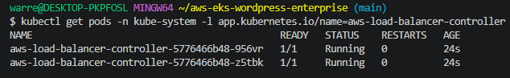
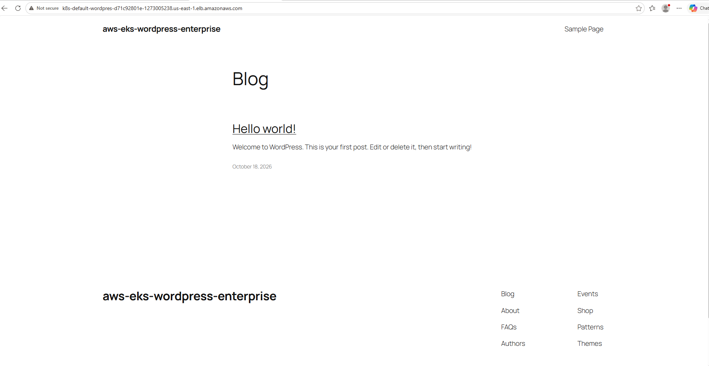
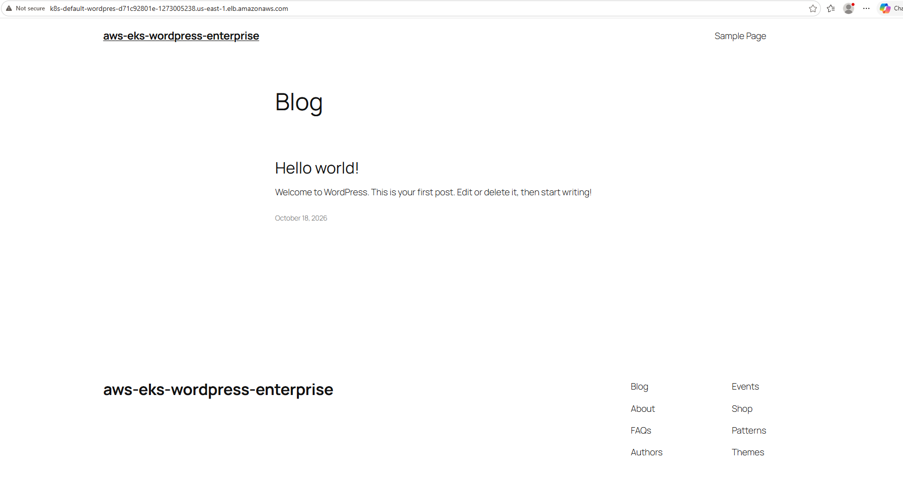
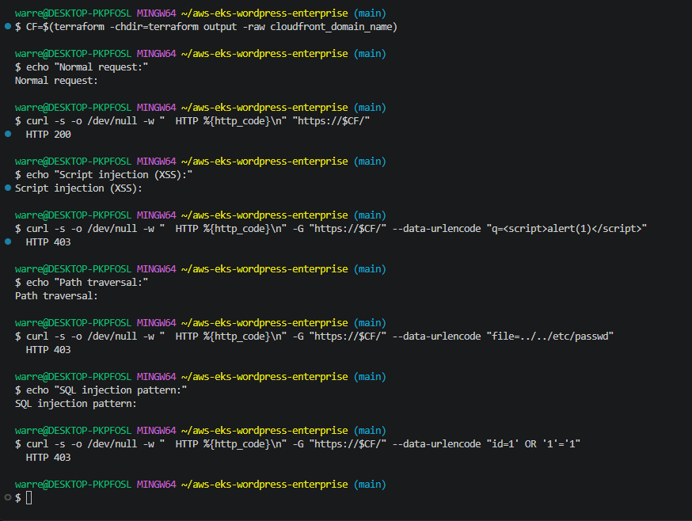
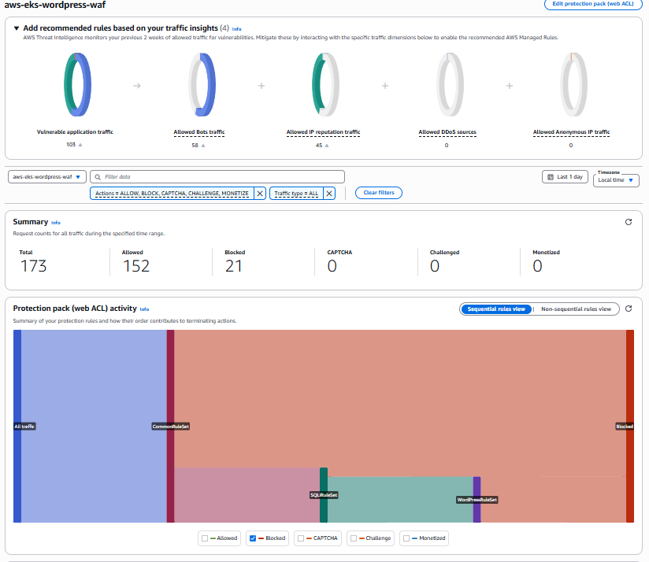
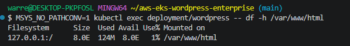
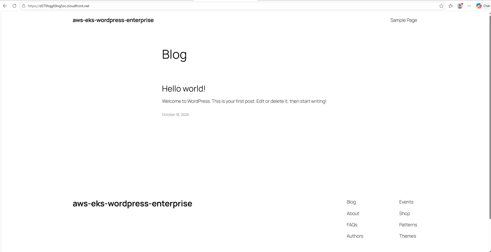
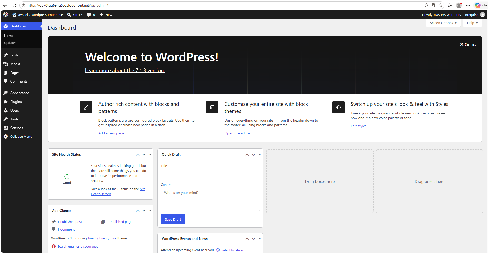
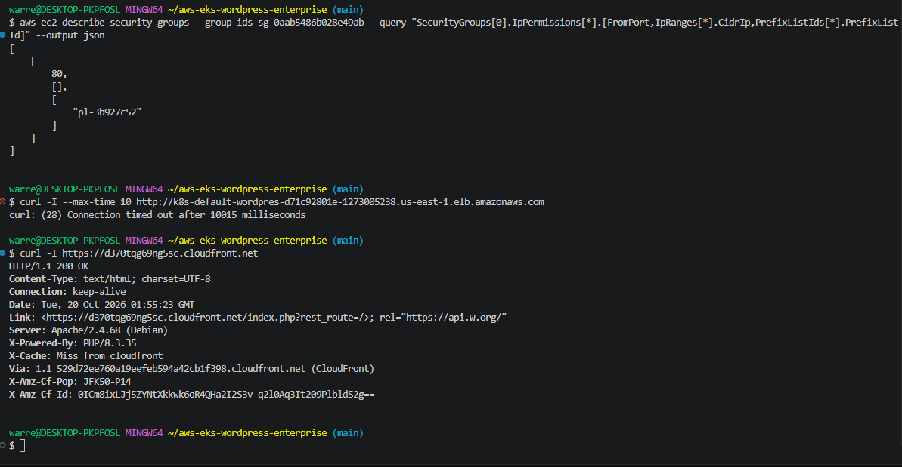

---

## ⚖️ Phase 5: Scalability & Resilience

### 🎯 Phase Objectives

- Move the cluster off an expiring Kubernetes version (`1.31`, in extended support) to a supported one (`1.35`) **without downtime**.
- Run WordPress as **two or more replicas spread across Availability Zones**, protected by a PodDisruptionBudget, so node maintenance and failures do not interrupt the site.
- Install **metrics-server** and make the **Horizontal Pod Autoscaler (HPA)** work, then prove it with a load test.
- Pin the WordPress image so every replica runs the same version.
- Match the node group to the architecture diagram (3–6 nodes).

### 🛠️ Step-by-Step Summary

#### 1. EKS Managed Add-ons

- CoreDNS, kube-proxy, and the VPC CNI were running as plain, self-managed Kubernetes objects, so they did **not** follow cluster upgrades (kube-proxy was a minor version behind).
- Adopted them as **EKS managed add-ons** through the Terraform module (`cluster_addons` with `most_recent = true`, resolving conflicts with `OVERWRITE`). The plan showed three creates and no destroys, and the site stayed up.

#### 2. High Availability for WordPress

- Scaled the Deployment to **2 replicas** and raised the HPA minimum to 2.
- Added a `topologySpreadConstraints` rule on `topology.kubernetes.io/zone` (`maxSkew: 1`) so replicas land in different Availability Zones.
  - *Lesson learned:* the first attempt used `whenUnsatisfiable: ScheduleAnyway`, which is only a preference. Both pods landed on the same node because the image was already cached there. Changing it to `DoNotSchedule` made the spread a requirement, and verification showed one pod per node and per zone.
- Added a **PodDisruptionBudget** (`wordpress-pdb`, `minAvailable: 1`) so a node drain can never remove both replicas at once. It was added only after two replicas were running, because with a single replica the budget would have blocked every drain.

#### 3. Zero-Downtime EKS Upgrade (1.31 → 1.35)

- **Why:** extended support bills the control plane at about $0.60/hr instead of $0.10/hr, and AWS automatically upgrades clusters at the end of extended support.
- **How:** EKS allows only one minor version at a time, so the cluster went `1.31 → 1.32 → 1.33 → 1.34 → 1.35`. Each hop was a one-line `cluster_version` change followed by the same routine: `terraform plan` (review), `terraform apply`, then verify.
- Each hop upgrades the control plane first, then replaces the managed nodes one at a time (new nodes on the new version, old ones drained), then updates the add-ons. The nodes already ran Amazon Linux 2023, so no AMI change was needed.
- A watcher loop showed the CloudFront URL returning `200` throughout, because the two replicas and the PodDisruptionBudget kept one pod serving at all times.
- Every hop ended with a clean `terraform plan` ("No changes") and a Git commit.

#### 4. metrics-server and the Security Group Fix

- Added `metrics-server` to the managed add-ons. The pods started, but the metrics API reported `False (FailedDiscoveryCheck)`: `context deadline exceeded` when the API server tried `https://<pod-ip>:10251`.
- **Root cause:** the metrics-server add-on listens on TCP `10251`, and the node security group did not allow the control plane to reach that port.
- **Fix:** added one least-privilege rule in `eks.tf` (`node_security_group_additional_rules`): TCP `10251`, source = the cluster security group only. The metrics API then became `True`, and `kubectl top` returned data.

#### 5. Horizontal Pod Autoscaler and Load Test

- HPA settings: `minReplicas: 2`, `maxReplicas: 5`, target **70% average CPU** (relative to the container's 100m request).
- Generated load with a pod inside the cluster (parallel `wget` loops against the `wordpress` Service), so the test did not involve CloudFront or the WAF.
- **Finding:** sustained load did **not** push CPU high. The pods spend most of their time waiting on the remote database (RDS) and network storage (EFS), not computing, so CPU-based scaling reacted only to short spikes. This is a real characteristic of WordPress on shared storage, and it is the reason for the Phase 6 work (Redis object cache and S3 media offload).
- To demonstrate the mechanism anyway, the HPA target was **temporarily lowered to 10%** for the test. The HPA scaled **2 → 5 replicas**, spread across both nodes (3 + 2). After restoring the 70% target from Git (`kubectl apply -f kubernetes/hpa.yaml`) and stopping the load, it scaled back **5 → 2** after the stabilization period.

#### 6. Pinned Image

- Replaced `wordpress:latest` with `wordpress:7.1.3-php8.3-apache`, matching the version already running (WordPress 7.1.3, PHP 8.3). A moving tag could let new pods pull a different version than the existing ones while sharing the same files and database.

#### 7. Node Group 3–6

- Resized the managed node group to min 3 / desired 3 / max 6 to match the architecture. The EKS Terraform module ignores `desired_size` after creation, so the live group was resized once with the AWS CLI and `eks.tf` was then updated to match. `terraform plan` confirmed "No changes".

### 📸 Portfolio Screenshots (Phase 5)

| Screenshot File Name | Visual Proof / Content Description |
| :--- | :--- |
| `docs/screenshots/phase5-metrics-server.png` | Metrics API `AVAILABLE: True`, plus `kubectl top nodes` and `kubectl top pods` returning live CPU and memory. |
| `docs/screenshots/phase5-hpa-scale-up.png` | HPA scaling from 2 to 5 replicas under load. *The target was temporarily lowered to 10% for this demonstration; the real target is 70%.* |
| `docs/screenshots/phase5-hpa-pods.png` | `kubectl get hpa` and `kubectl get pods -o wide` at 5 replicas, spread across both nodes and Availability Zones. |
| `docs/screenshots/phase5-hpa-scale-down.png` | HPA back at 2 replicas with the real 70% target after the load stopped. |

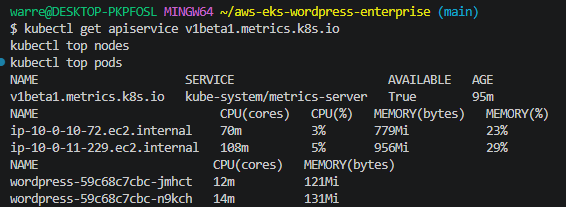
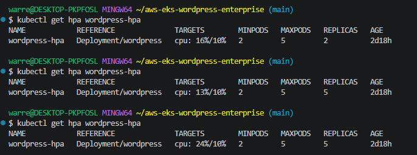
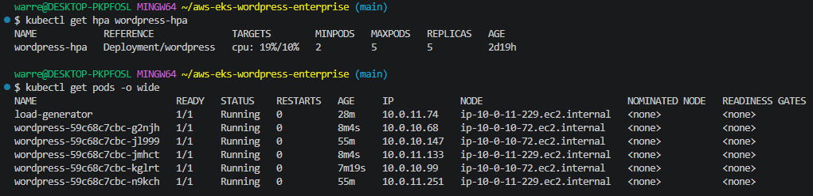
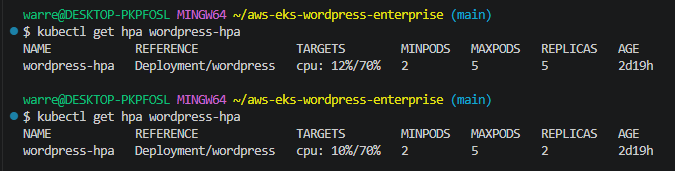

---

## ⚡ Phase 6: Performance (Redis Object Cache & S3 Media Offload)

> **Note:** Account-specific identifiers (the AWS account ID and the Redis endpoint host) are shown as placeholders in this section.

### 🎯 Phase Objectives

- Cut the number of database round trips per page by adding a **Redis object cache** (Amazon ElastiCache).
- Stop storing uploaded media on the shared EFS volume only: copy it to a **private S3 bucket** and serve it through **CloudFront**.
- Give the WordPress pods access to S3 with **IRSA** (temporary, role-based credentials) instead of access keys.
- Prove each piece with measurements and screenshots.

### 🏗️ Traffic Flow

```text
Pages:  Browser ──▶ CloudFront ──▶ ALB (WAF) ──▶ WordPress pods ──▶ RDS MySQL / EFS
                                                        └──────────▶ ElastiCache Redis (object cache)

Media:  Browser ──▶ CloudFront ──(OAC, /wp-content/uploads/*)──▶ private S3 bucket
Upload: WordPress pod ──(IRSA role)──▶ S3 bucket
```

### 🛠️ Part A: Redis Object Cache

#### 1. ElastiCache for Redis (`redis.tf`)

- Created a Redis 7.1 **replication group** (`aws-eks-wordpress-redis`): `cache.t3.micro`, two nodes in different Availability Zones, **automatic failover and Multi-AZ** enabled, encryption at rest enabled, no snapshots (a cache can be rebuilt).
- Placed it in a subnet group of the private subnets.
- Created a dedicated security group that allows TCP `6379` **only from the EKS worker node security group**.

#### 2. WordPress Integration

- Installed the **Redis Object Cache** plugin and set the `WP_REDIS_*` constants (host, port, `predis` client, short timeouts, and a cache key salt) through `WORDPRESS_CONFIG_EXTRA` in the Deployment, so the settings live in Git and are identical on every pod.
- The official WordPress image evaluates `WORDPRESS_CONFIG_EXTRA` as PHP on every request instead of writing it into `wp-config.php`. A `grep` of `wp-config.php` for the Redis constants therefore finds nothing, even though they are active.
- Short Redis timeouts mean a Redis outage slows WordPress down instead of hanging it.

#### 3. Results

- The plugin reported a connected cache with a hit rate of about **98%**.
- Page timings (same pages, before and after enabling the cache):

| Page | Before | After |
| :--- | :--- | :--- |
| Front page | 0.392 s | 0.363 s |
| Search | 0.450 s | 0.331 s |

- The gain is modest on a small test site. It grows with the number of database queries per page, which is the cost the cache removes.

### 🛠️ Part B: S3 Media Offload Through CloudFront

#### 1. Private S3 Bucket (`s3.tf`)

- Created `aws-eks-wordpress-media-<account-id>` with **Block All Public Access** on, `BucketOwnerEnforced` object ownership (no ACLs), and default AES256 encryption.

#### 2. CloudFront as the Only Reader (`cloudfront_media.tf`, `cloudfront.tf`)

- Added an **Origin Access Control (OAC)** with SigV4 signing and a second origin on the distribution for the bucket.
- Added an ordered cache behavior for `/wp-content/uploads/*` that sends those paths to S3 with the managed **CachingOptimized** policy. All other paths still go to the ALB with caching disabled.
- The bucket policy allows `s3:GetObject` only to the CloudFront service principal, and only when `AWS:SourceArn` matches this distribution. A direct request to the bucket returns **403**.

#### 3. IRSA for the WordPress Pods (`irsa_wordpress.tf`, `wordpress-serviceaccount.yaml`)

- Created the IAM role `aws-eks-wordpress-media-role` whose trust policy accepts only the EKS OIDC provider, for the subject `system:serviceaccount:default:wordpress` and the audience `sts.amazonaws.com`.
- Permissions are limited to this bucket: `GetObject`, `PutObject`, and `DeleteObject` on the objects, and `ListBucket`, `GetBucketLocation`, `GetBucketPublicAccessBlock`, and `GetBucketOwnershipControls` on the bucket.
- Created the `wordpress` ServiceAccount with the annotation `eks.amazonaws.com/role-arn`, and set `serviceAccountName: wordpress` in the Deployment. The pods then receive `AWS_ROLE_ARN` and `AWS_WEB_IDENTITY_TOKEN_FILE`, so no access keys exist anywhere.

#### 4. WP Offload Media Lite

- Configured through the `AS3CF_SETTINGS` constant (bucket, region, `use-server-roles`, the `wp-content/uploads/` prefix, and the CloudFront domain as the delivery domain). The plugin shows these fields as *Defined in wp-config.php* and reports **"Storage provider is successfully connected"**, which confirms IRSA works end to end.
- The plugin also shows a *Block All Public Access* warning on the delivery tab. This is expected: it assumes the bucket is read directly, while here only CloudFront reads it.
- `remove-local-file` stays off, so each file exists on both EFS and S3, which keeps a safe fallback.

#### 5. Verification

- Uploaded an image through the Media Library. S3 received the original plus four resized versions under `wp-content/uploads/<year>/<month>/<version>/`.
- Requests to the CloudFront URL returned `200` with `Server: AmazonS3`, and repeated `GET` requests showed `x-cache: Hit from cloudfront` after the first miss.
- A request straight to the S3 URL returned `403 Forbidden`.

### 🧯 Problems Found and Fixed

#### WAF body-size rule blocked media uploads

- **Symptom:** uploads failed in the Media Library with "The server cannot process the image", and later `/wp-admin/media-new.php` returned a bare `403 Forbidden`. Nothing appeared in the pod logs and the pods had no restarts.
- **Diagnosis:** this WAF is attached to the **ALB**, so the block happened there. `get-sampled-requests` for each rule group showed every blocked request came from one rule, `SizeRestrictions_BODY` in the Common Rule Set, on `POST /wp-admin/async-upload.php` and `/wp-admin/media-new.php`. The SQL injection and WordPress rule groups blocked nothing.
- **Fix:** changed only that rule to **count** and added a custom rule (priority 5) that **blocks request bodies over 8 KB everywhere except `/wp-admin/` and `/wp-json/`**. Public pages keep the size protection, while uploads and the editor, which sit behind the WordPress login, work.
- **Side finding:** one sampled request was blocked by `CrossSiteScripting_BODY` on an upload. Binary image data can occasionally look like script to that rule. This is recorded under Known Limitations.

#### Plugin install timed out through CloudFront

- Installing the plugin from wp-admin failed twice: first with "Could not copy file" part-way through, then with a CloudFront `504 Gateway Timeout`. Copying hundreds of small files onto EFS is slow, and CloudFront stops waiting for the origin after about 30 seconds.
- **Fix:** removed the half-copied folder, downloaded the plugin zip from inside the pod, extracted it into `wp-content/plugins/`, and activated it in wp-admin (activation is a fast database change). Commands run inside the pod avoid the web request and its timeout.

### 📸 Portfolio Screenshots (Phase 6)

| Screenshot File Name | Visual Proof / Content Description |
| :--- | :--- |
| `docs/screenshots/phase6-redis-connected.png` | Redis Object Cache plugin reporting a connected cache. |
| `docs/screenshots/phase6-redis-cache-stats.png` | Cache statistics showing a hit rate of about 98%. |
| `docs/screenshots/phase6-redis-timing.png` | Page timings before and after enabling the object cache. |
| `docs/screenshots/phase6-s3-cloudfront-test.png` | A test object in the private bucket served through CloudFront, with the direct S3 request refused. |
| `docs/screenshots/phase6-s3-plugin-connected.png` | WP Offload Media Lite storage settings: bucket connected through the IRSA role. |
| `docs/screenshots/phase6-s3-plugin-delivery.png` | Delivery settings defined in `wp-config.php`, with the CloudFront domain and URL preview. |
| `docs/screenshots/phase6-s3-upload-media-library.png` | Image uploaded through the WordPress Media Library. |
| `docs/screenshots/phase6-s3-bucket-objects.png` | `aws s3 ls` showing the original and four resized versions in the bucket. |
| `docs/screenshots/phase6-s3-cloudfront-hit.png` | Repeated requests to the CloudFront media URL: one miss, then cache hits. |
| `docs/screenshots/phase6-s3-direct-403.png` | The same file requested directly from S3 returning `403 Forbidden`. |
| `docs/screenshots/phase6-waf-sizerestrictions-block.png` | WAF sampled requests showing `SizeRestrictions_BODY` blocking upload requests. |

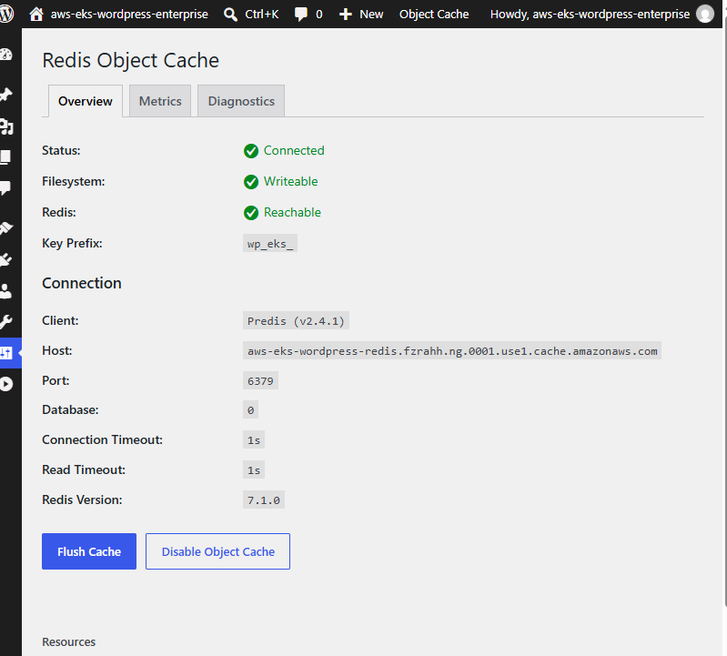
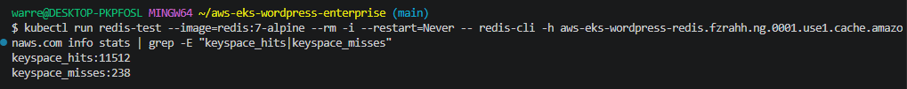
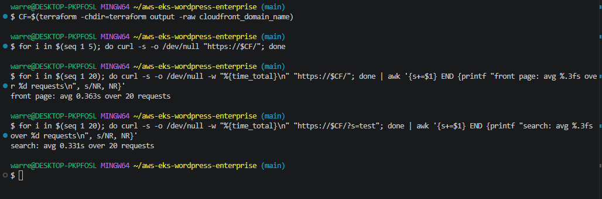
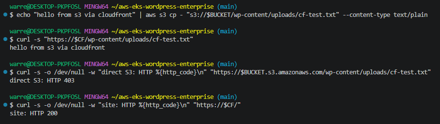
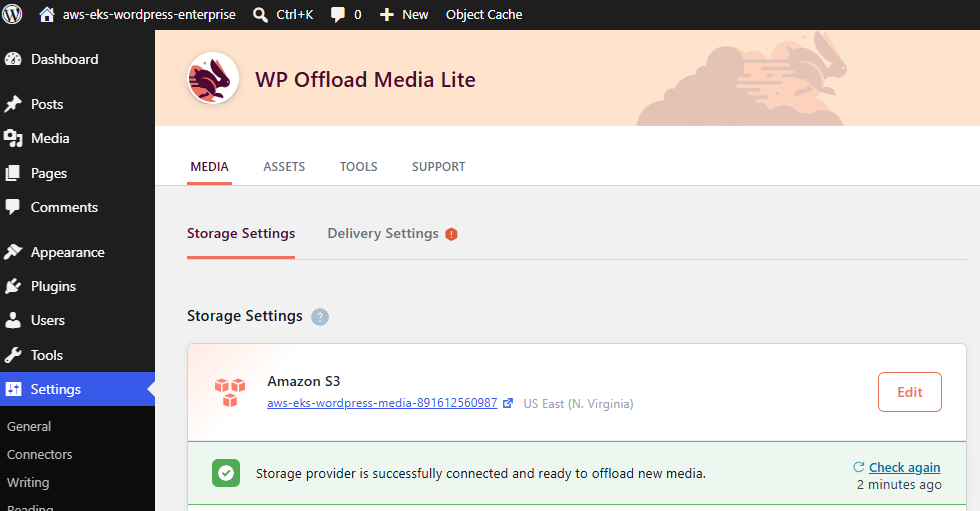
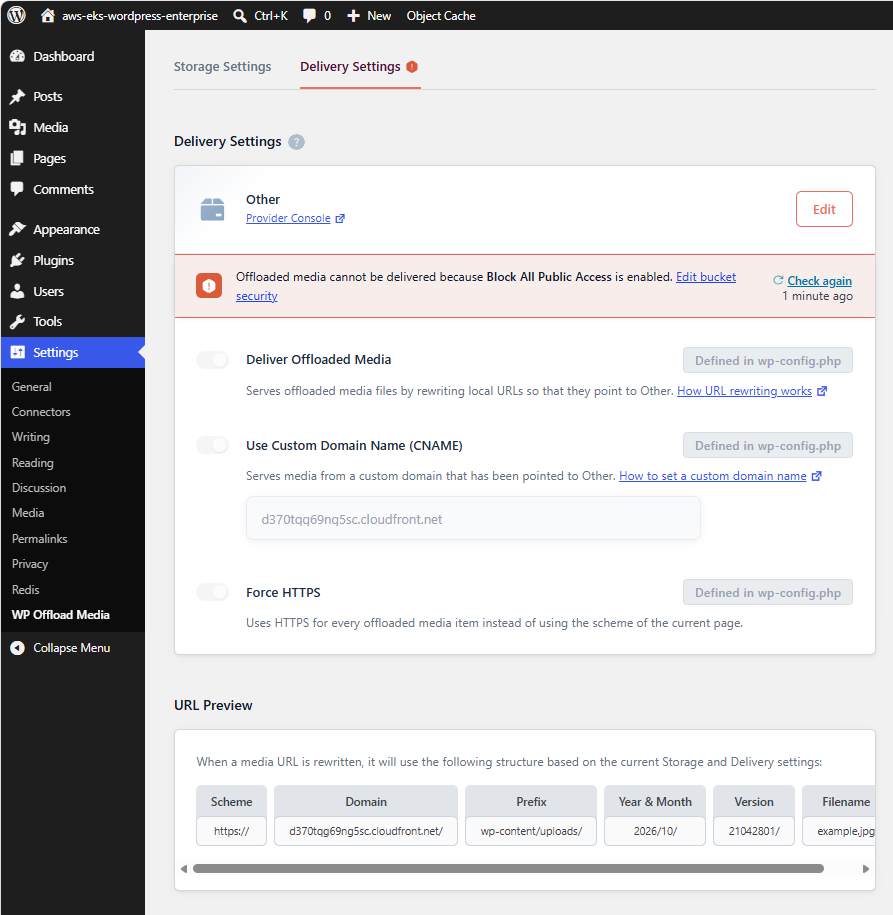
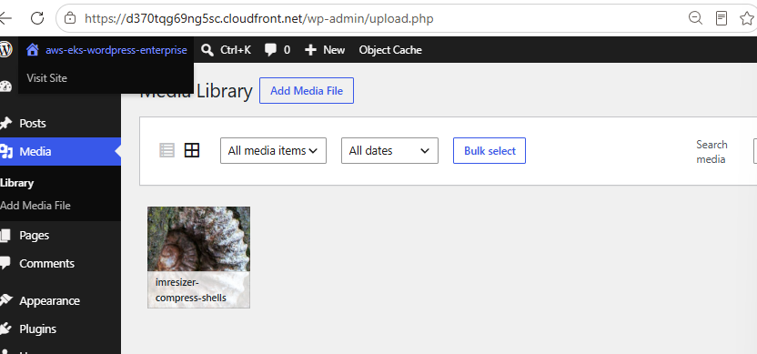
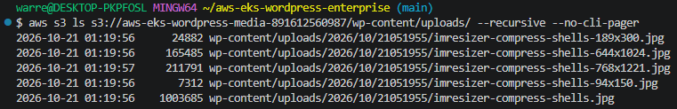
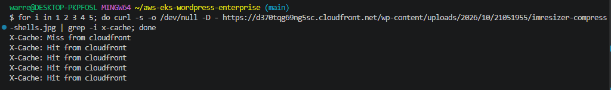
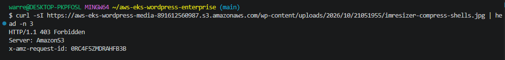
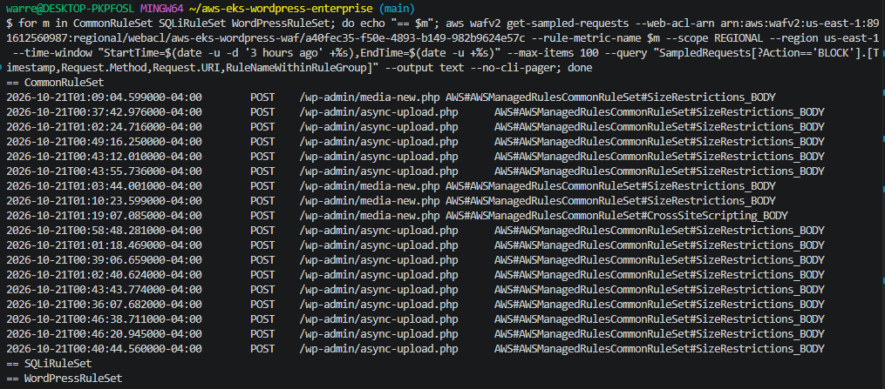

---

## 🤖 Phase 7: Automation (Remote State & CI/CD)

### 🎯 Phase Objectives

- Move Terraform state off the laptop into a remote, locked, versioned store (HCP Terraform).
- Run `terraform fmt`, `validate` and `plan` automatically on every pull request.
- Apply to AWS only from `main`, only after a human approves, with no long-lived AWS keys anywhere.

### 🛠️ Implementation Steps

#### 1. Remote state in HCP Terraform

- Added a `cloud` block to `terraform/main.tf` (organization and workspace) and ran `terraform init`, which copied the existing state (103 resources) to HCP Terraform. A dated backup of the local state was kept until the migration was verified, and the local state file was then removed.
- The workspace **execution mode is Local**: HCP only stores and locks the state, while plans and applies run on my laptop or in GitHub Actions. This keeps AWS credentials out of HCP.
- A clean `terraform plan` after migration confirmed that nothing changed.

#### 2. GitHub-to-AWS trust with OIDC (`github_oidc.tf`)

- Created an IAM OpenID Connect provider for `token.actions.githubusercontent.com`. Each workflow run receives a short-lived signed token from GitHub, and AWS exchanges it for temporary credentials. No access keys are stored in GitHub.
- Two IAM roles with different trust conditions:
  - **Plan role** (`ReadOnlyAccess`): assumable from pull requests and `main`.
  - **Apply role** (`AdministratorAccess`): assumable only from the `production` environment, which requires a manual approval.
- The role ARNs are stored as repository **variables** (not secrets, since they are not sensitive). The database password and the HCP token are repository **secrets**.

#### 3. The workflow (`.github/workflows/terraform.yml`)

- **Pull requests:** `fmt -check`, `init`, `validate`, `plan`, using the read-only role.
- **Push to `main`:** the same checks, then an **Apply** job that waits for approval in the `production` environment before running `terraform apply`.
- `concurrency` ensures only one run touches the state at a time, and `permissions: id-token: write` lets the job request the OIDC token.

### 🧯 Problems Found and Fixed

#### AWS rejected the GitHub token ("Not authorized to perform sts:AssumeRoleWithWebIdentity")

- AWS gives this same generic message for any trust mismatch. A temporary debug step that printed the token's claims showed GitHub now puts **immutable numeric IDs** in the subject, for example `repo:<owner>@<id>/<repo>@<id>:pull_request`, instead of plain names. The role trust conditions were updated to match, applied locally first, and the debug step was then removed.

#### `terraform fmt -check` failed in CI

- `vpc.tf` used inconsistent indentation. Formatting it with `terraform fmt` fixed the check, with no value changes.

#### The plan differed between my laptop and CI

- The EKS module adds whoever runs Terraform to the KMS key policy, so CI saw a one-resource change that the laptop did not. Pinning `kms_key_administrators` to the admin user and the apply role made the plan identical everywhere, and CI now reports **"No changes"**.

### ✅ Verification

- A pull request ran the checks and showed a plan with no changes.
- After merging to `main`, the apply job paused at the approval gate. After approval it finished with `Apply complete! Resources: 0 added, 0 changed, 0 destroyed.`, which proves the full chain: OIDC to AWS, remote state, refresh, and comparison.

### 📸 Portfolio Screenshots (Phase 7)

| Screenshot File Name | Visual Proof / Content Description |
| :--- | :--- |
| `docs/screenshots/phase7-hcp-workspace-settings.png` | HCP Terraform workspace with execution mode set to Local. |
| `docs/screenshots/phase7-hcp-state-migrated.png` | HCP Terraform workspace showing the migrated state and its resources. |
| `docs/screenshots/phase7-github-environment.png` | The `production` environment with required reviewers. |
| `docs/screenshots/phase7-github-secrets.png` | Repository secrets (names only, values hidden). |
| `docs/screenshots/phase7-github-variables.png` | Repository variables holding the role ARNs. |
| `docs/screenshots/phase7-actions-pr-plan-success.png` | The pull-request plan step finishing with no changes. |
| `docs/screenshots/phase7-actions-run-summary.png` | Workflow run summary. |
| `docs/screenshots/phase7-actions-steps-green.png` | All validation and plan steps green. |
| `docs/screenshots/phase7-actions-apply-success.png` | Approved apply job finishing with 0 added, 0 changed, 0 destroyed. |

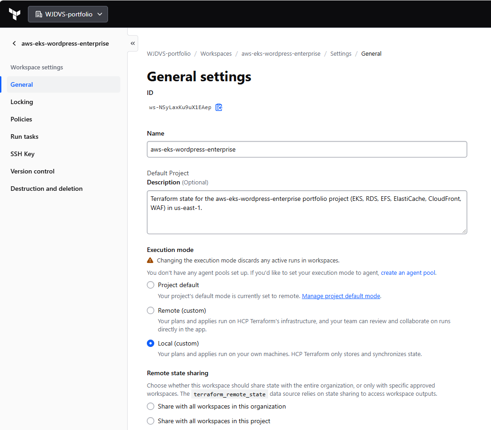
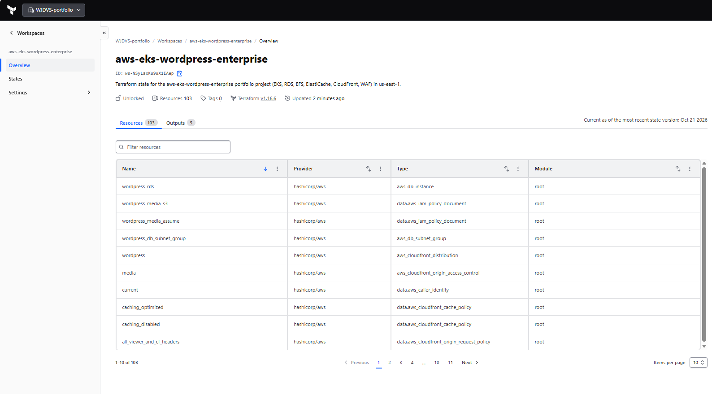
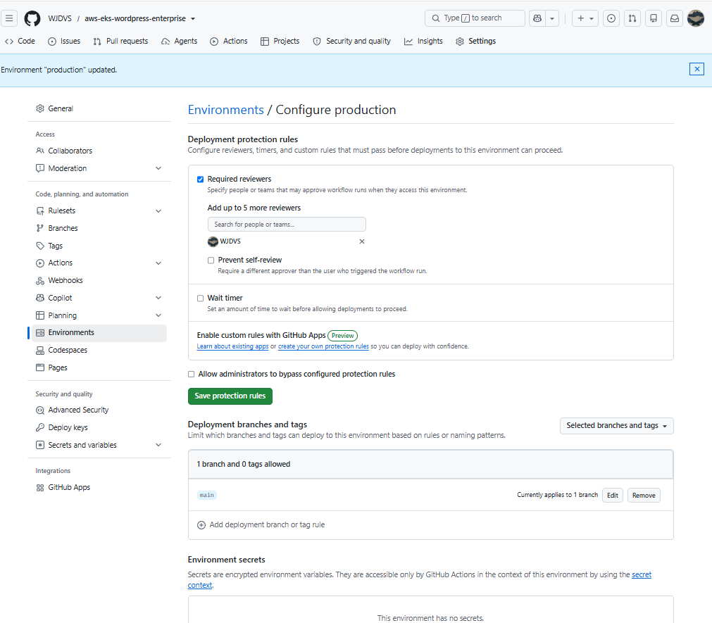
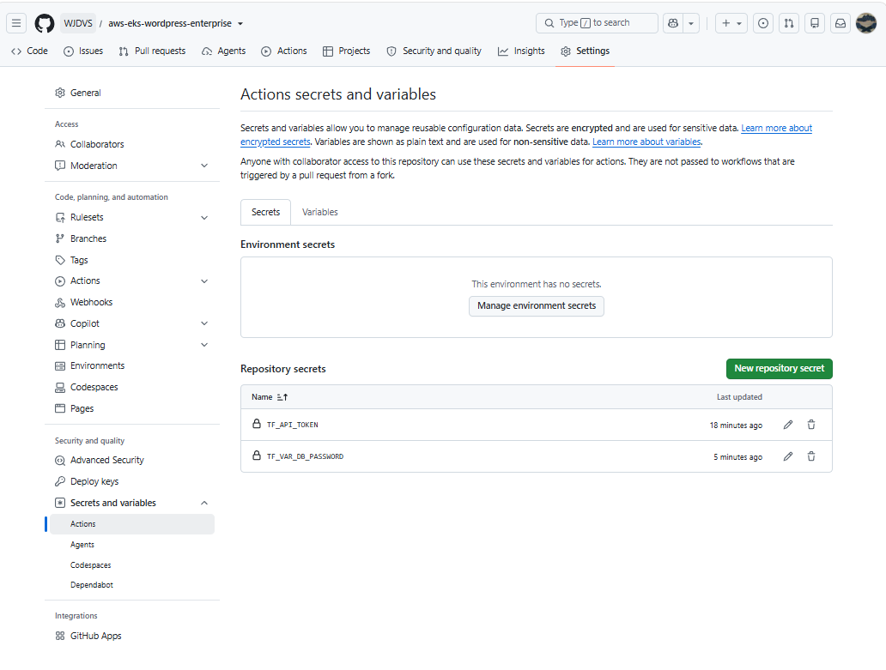
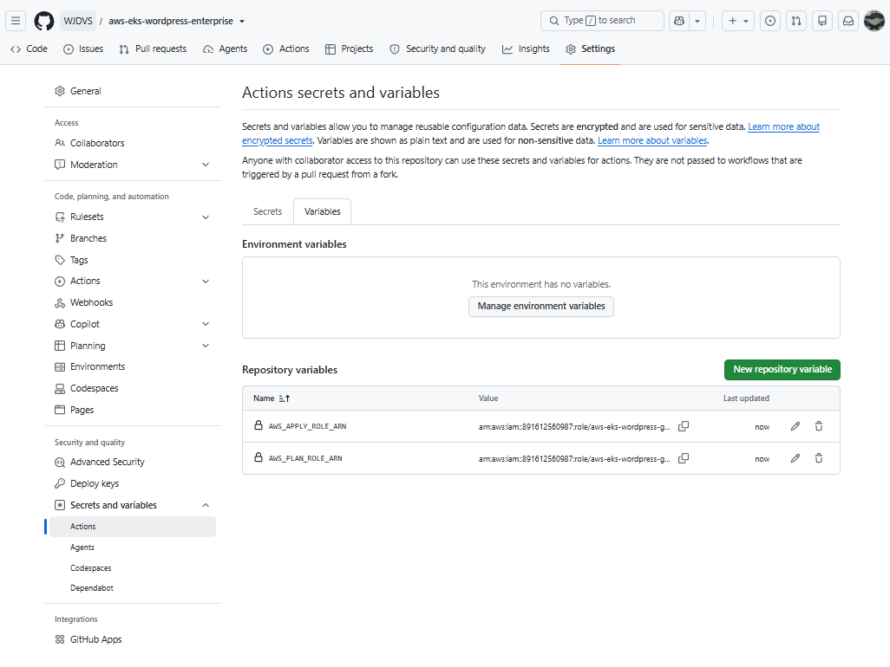
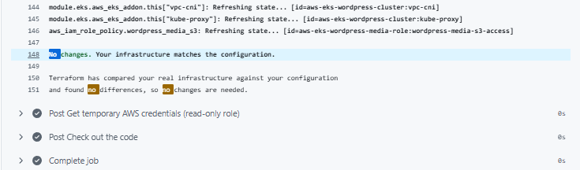
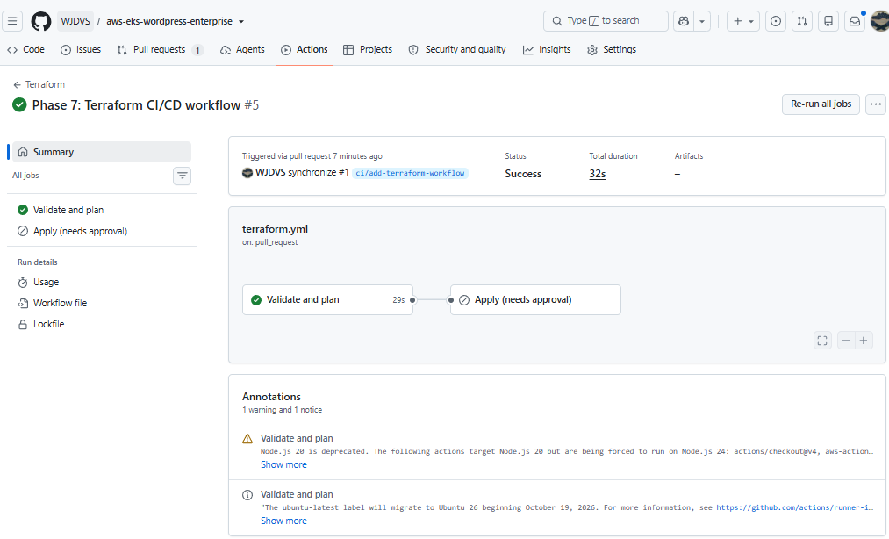
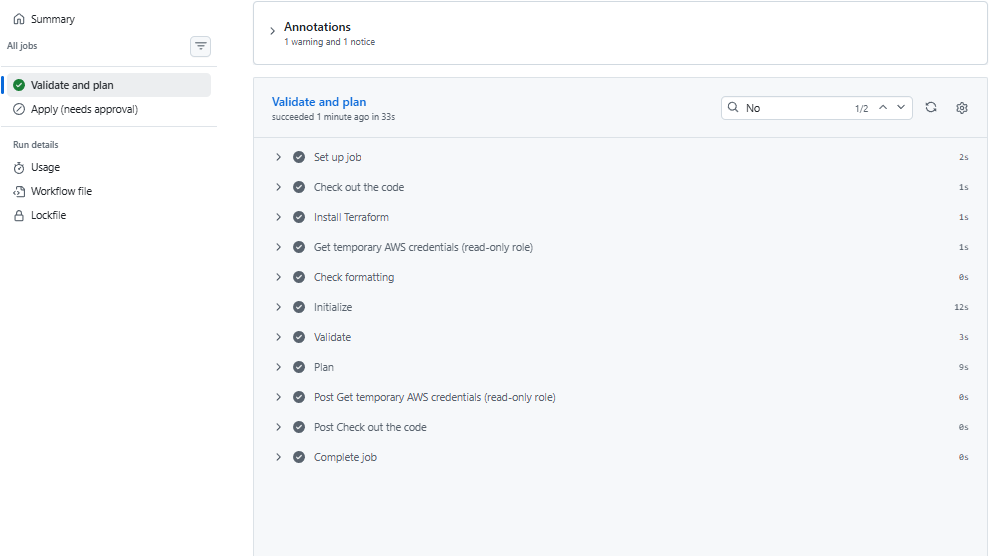
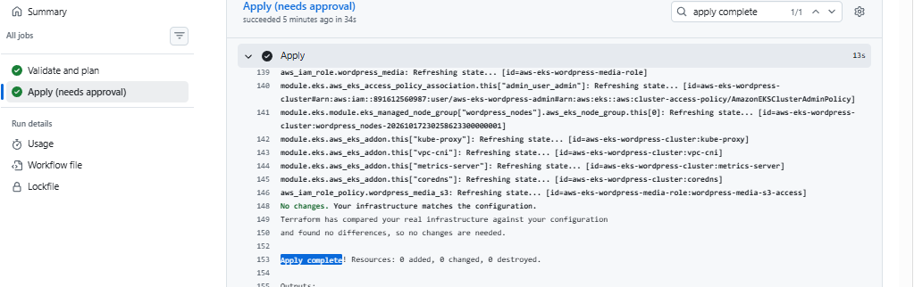

---

## ⚠️ Known Limitations and Next Improvements

**Current limitations**

- **CloudFront-to-ALB traffic is plain HTTP.** There is no custom domain, so there is no certificate for the ALB. A domain plus an ACM certificate would encrypt that leg.
- **Minimum TLS version is fixed at TLS 1.0** because the default CloudFront certificate is used. A custom domain and certificate would allow requiring TLS 1.2 or newer.
- **WAF request logging is off.** Metrics and sampled requests are enabled. Full logging to CloudWatch or S3 would add cost.
- **Secrets are Kubernetes Secrets**, which are base64-encoded. AWS Secrets Manager with automatic rotation is the stronger option.
- **The HPA scales pods, not nodes.** The node group is a fixed 3–6 range managed by Terraform. A node autoscaler (Cluster Autoscaler or Karpenter) would grow it automatically.
- **CPU-based autoscaling suits CPU-bound work.** WordPress here is mostly I/O-bound (database and EFS), so caching and offload (Phase 6) matter more than adding replicas.
- **Redis traffic is not encrypted in transit and has no auth token.** Encryption at rest is on and access is limited by security group to the worker nodes. In-transit TLS plus an auth token would harden it.
- **Some uploads may still be blocked by the WAF.** The body-size exception covers `/wp-admin/` and `/wp-json/` only, and the managed `CrossSiteScripting_BODY` rule can occasionally match binary image data. The remedy would be a similar narrow override, left out to avoid weakening the WAF further.
- **Large uploads can hit CloudFront's 30-second origin timeout** and WordPress's image-processing memory limits. A very large photo failed to upload; a small image worked. Raising the CloudFront origin response timeout and the pod and PHP memory limits would help.
- **Media is kept on both EFS and S3** (`remove-local-file` is off), which is safe but uses more storage.
- **The media bucket name contains the AWS account ID.** This is not a secret, but it is visible in the Terraform and the screenshots.
- **The CI apply role has AdministratorAccess.** Terraform manages IAM, VPC, EKS and more, so a narrow policy is hard to write. The risk is limited by trust conditions: only the `production` environment of this repository can assume it, and every apply needs a manual approval. A scoped-down policy would be the next step.
- **CI covers Terraform only.** The Kubernetes manifests are still applied manually with `kubectl`.
- **The repository is public, so workflow logs are public.** Plan output (resource names and ARNs, including the AWS account ID) is visible. Secrets are masked by GitHub, and the database password is passed as a repository secret.
- **The HCP Terraform API token used by CI expires** (30 days) and must be replaced in the repository secrets when it does. Execution mode is Local, so HCP only stores state.
- **Workflow actions are pinned by version tag, not commit SHA**, and Dependabot is not enabled. GitHub currently reports a Node.js 20 deprecation notice for some actions and an `ubuntu-latest` migration notice.
- **An old, since-rotated database password remains in git history** (`rds.tf`). It no longer works, but a history rewrite would be required to remove it.
- **Commit author email is public in older commits.** Commits before the switch to a GitHub noreply address carry a personal email address.
- **Cost awareness:** the EKS control plane, worker nodes, NAT gateway, ALB, Multi-AZ RDS, and WAF all accrue hourly charges while the environment runs.
- **Teardown order:** delete the Ingress first (so the controller removes the ALB and detaches its security groups), empty the media bucket (`aws s3 rm s3://<bucket> --recursive`, because the bucket has no `force_destroy`), then run `terraform destroy` for the remaining infrastructure.

**Optional hardening (documented, not built)**

- Custom domain with ACM certificates (end-to-end TLS)
- AWS Secrets Manager with rotation
- WAF logging
- Automatic node scaling (Cluster Autoscaler or Karpenter)

---

## 🗺️ Roadmap

| Phase | Focus | Planned Work | Status |
| :--- | :--- | :--- | :--- |
| **Phase 5** | Scalability | metrics-server, HPA, 2+ replicas across zones, PDB, EKS 1.35, node group 3–6 | ✅ Complete |
| **Phase 6** | Performance | Amazon ElastiCache for Redis (object cache), Amazon S3 media offload served through CloudFront, IRSA | ✅ Complete |
| **Phase 7** | Automation | Remote Terraform state (HCP Terraform), GitHub Actions CI/CD with OIDC and an approval gate | ✅ Complete |
| **Final** | Documentation | Portfolio documentation and final end-to-end verification | 🔜 Planned |
